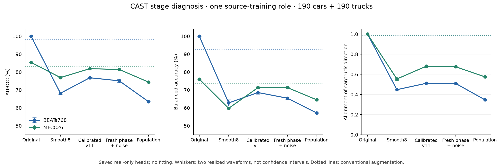

# Bounded CAST stage diagnosis

2026-10-25. **Two losses are visible: smooth8 reconstruction already changes the
real head's decision structure substantially, and the fitted population introduces
another mismatch after calibrated parent reconstruction. Calibration is helpful
overall in this role. Fresh phase/noise explains only a smaller part of the gap.**

This completes the requested bounded diagnosis. It is a source-training diagnostic,
not another CAST utility experiment or independent generalization result. The
100% BEATs original score is training performance of the existing overfitted head;
some lost cues may be recording-context shortcuts. Recovering these scores would
not, by itself, demonstrate better vehicle recognition on held recordings.

## Fixed scope

- Protocol: [`cast_stage_diagnosis_v1`](../../experiments/cast_utility/stage_diagnostic/PROTOCOL.md),
  frozen before new waveform/feature scores. User authorization: run the bounded
  original → reconstruction → calibration → population diagnosis.
- Exactly CAST-5A role `utility_s42_0`, **380 existing training parents: 190 cars,
  190 trucks**, five conservative source groups; admitted IDMT_V1 CH34.
- Two historical checking realizations of smooth8 and calibrated v11; two fresh
  phase/noise realizations of the same final controls. A preselected 50-parent
  subset traces v7/v8/v9/v10, five parents/class/group.
- **2,680 unique two-second diagnostic waveforms**, regenerated from saved controls;
  10 original encoder controls. No optimization, new heads/scalers, new population,
  new dataset audio, held scoring or target evaluation. Existing population and
  conventional-augmentation features retain their original budgets and profiles.
- Frozen BEATs768/MFCC26, original real-only R and CAST-only C heads, original
  train-fitted scalers and fixed decision rule. All flags are retained. Original
  sessions and physical vehicle identities remain unknown where not established.

## Primary result: same 380 training parents

The table uses the **saved real-only R head** throughout. Reconstruction rows are
means of the two declared realizations, each scored on the same 380 parents. Original,
RA and population rows use their existing single feature bank. Population samples
are unconditional draws; they are not paired reconstructions of those parents.

| Input stage | BEATs AUROC | BEATs BA | BEATs truck recall | MFCC AUROC | MFCC BA |
|---|---:|---:|---:|---:|---:|
| Original training observations | 100.00% | 100.00% | 100.00% | 85.39% | 76.05% |
| Conventional augmentation (RA reference) | 98.11% | 92.63% | 90.00% | 83.07% | 73.42% |
| Smooth8 reconstruction | **68.16%** | **62.76%** | 53.42% | **76.91%** | 59.74% |
| Calibrated v11, historical checking streams | **76.82%** | **68.55%** | 53.42% | **81.87%** | 71.32% |
| Same v11 controls, fresh phase/noise | **75.10%** | **65.39%** | 50.00% | **81.44%** | 71.32% |
| Existing v15 population samples | **63.44%** | **57.11%** | 30.53% | **74.39%** | 64.47% |

Whiskers show the range of the two declared realizations, **not confidence
intervals**. Dotted lines are the conventional-augmentation reference. There is
one fixed role, not 30 new independent repeats. Full C-head projections and all
group/class outcomes remain in the external results and the compact summary.

### 1. A large mismatch is present before calibration

Smooth8 reduces BEATs training-parent AUROC by **31.84 points** relative to the
originals; MFCC falls **8.48 points**. Ordinary augmentation loses only 1.89 and
2.32 AUROC points on the same parents. Thus the renderer/fitted-control interface
does not preserve the real head's structure even before population sampling.

This does **not** separate renderer capacity, the spectral fitting objective,
optimizer/winner choice or the head's dependence on nuisance cues. No fitting
alternative or physical mechanism was varied. The result supports targeting
this interface, rather than assuming that adding more population draws will
restore information not retained in individual reconstructions.

### 2. Calibration partly repairs the mismatch

Smooth8 → calibrated v11 improves AUROC by **8.66 BEATs / 4.96 MFCC points** and
balanced accuracy by **5.79 / 11.58 points**. The BEATs truck recall mean stays at
53.42%; most of its BA recovery comes from car recall rising 72.11% → 83.68%.

The final calibration chain is not globally destroying the signal. Its net
effect in this role is beneficial, although the 50-parent trace below shows
non-monotonic intermediate changes. Final controls remain effective observation
parameters, not recovered RPM, load or clean physical sources.

### 3. Checking-realization dependence is smaller, but not absent

Fresh phase/noise changes BEATs AUROC **76.82% → 75.10%** (−1.71 points) and BA
**68.55% → 65.39%** (−3.16). MFCC AUROC changes **81.87% → 81.44%** (−0.43), with
unchanged mean BA. The calibrated parameters are identical across this comparison;
phase and noise change jointly, so their individual contributions are unknown.

Across the two fresh draws, BEATs AUROC is 74.34–75.86%; the checking range is
76.57–77.07%. These two-draw ranges are descriptive sensitivity, not precision
over sessions. They cannot establish a general rate of checking-stream overfit.

### 4. Population construction/sampling adds another gap

The fresh-parent-to-population comparison falls **11.66 BEATs / 7.06 MFCC AUROC
points**, with BA falling **8.29 / 6.84 points**. BEATs truck recall goes from
50.00% to **30.53%**. This additional loss remains after refreshing phase/noise.

The comparison includes the fitted prior's transformations, class/group effects,
width, conditional dependencies, sample composition and finite-sampling variation.
It does not isolate which population block causes the loss. The 380 population
samples are not matched to the 380 individual parents, so these are descriptive
distribution comparisons, not paired waveform treatment effects.

## Feature geometry agrees with the score changes

All geometry uses the existing R head's real-training StandardScaler. “Alignment”
is cosine between original and generated truck-minus-car centroid directions.
Centroid displacement is divided by the original class-centroid separation, not
by within-class standard deviation.

| Input | BEATs direction alignment | BEATs car/truck displacement | MFCC direction alignment |
|---|---:|---:|---:|
| Conventional augmentation | 0.987 | 0.32 / 0.32 | 0.988 |
| Smooth8 | 0.448 | 5.38 / 5.37 | 0.554 |
| Calibrated v11 | 0.511 | 4.94 / 5.11 | 0.681 |
| Fresh v11 | 0.510 | 4.96 / 5.13 | 0.675 |
| Population | 0.347 | 4.91 / 5.13 | 0.575 |

Population sampling does not mainly add a larger centroid offset: its absolute
offset is similar to calibrated parents, while its class-direction alignment
deteriorates. That favors examining how the prior changes class-dependent
relationships, rather than treating the problem solely as global coloration.
Centroid geometry remains coordinate sensitive and does not characterize the
full joint distribution or identify physical causes.

## Secondary trace: exact same 50 parents at every stage

The subset was fixed before scoring: lexicographically first five training IDs
per class/group, 25 cars + 25 trucks. These are two-realization means. Its different
values must not be compared as though it were the full 380-parent population.

| Stage | BEATs AUROC | BEATs BA | MFCC AUROC | MFCC BA |
|---|---:|---:|---:|---:|
| Original | 100.00% | 100.00% | 83.20% | 72.00% |
| Smooth8 | 63.12% | 62.00% | 73.20% | 58.00% |
| v7 mixture calibration | **73.68%** | 69.00% | **77.76%** | 57.00% |
| v8 envelope calibration | 71.52% | 69.00% | 74.96% | 55.00% |
| v9 spectrum calibration | **67.84%** | 67.00% | **71.52%** | 54.00% |
| v10 temporal calibration | 68.40% | 67.00% | 72.88% | 54.00% |
| v11 spectral-resolution calibration | **73.60%** | 65.00% | **81.04%** | 70.00% |

The mixture calibration initially helps ranking in both representations. The
v8/v9 changes then reduce ranking on this subset; v11 recovers it. V10 changes
BEATs recall balance sharply (car 66% → 88%, truck 68% → 46%) despite unchanged
mean BA at 67%. Descriptor calibration can therefore alter class behavior even
when a scalar aggregate looks stable. This small diagnostic does not justify
removing a stage or selecting a winner without a new frozen comparison.

## Group outcomes and uncertainty

All original training groups are retained. The numbers below are mean BEATs
R-head AUROCs over the two relevant realizations. Group IDs describe conservative
provenance groupings, not known independent sessions or physical vehicles.

| Training group | Cars / trucks | Smooth8 | v11 checking | v11 fresh |
|---|---:|---:|---:|---:|
| `connected_654b5df57ec64387` | 38 / 56 | 61.58% | 78.36% | 75.73% |
| `connected_667018ac7661cccb` | 38 / 14 | 51.13% | 68.61% | 69.55% |
| `connected_72766641e1daf436` | 38 / 55 | 72.25% | 78.59% | 77.01% |
| `connected_b00d69ddbb66d0fe` | 38 / 10 | 53.16% | 61.84% | 56.45% |
| `connected_c6148cf0cafb5753` | 38 / 55 | 69.74% | 71.34% | 67.32% |

The original BEATs R head has 100% AUROC in each of these training groups. Poor
reconstruction alignment is therefore visible across all five, not one selected
group. Calibration improves ranking in all five; fresh-stream changes vary by
group. Only 10/14 trucks occur in two groups. No clip bootstrap, p-value, new
practical threshold or claim of session-population uncertainty is attached.

## Decision

**Keep two separate development targets: reconstruction alignment and population
class relationships.** Do not discard the final calibration chain based on the
previous population-only gap. Do not attribute the whole problem to noise seeds,
or expect more samples from the unchanged v15 prior to repair the early mismatch.

The smallest next CAST work is a separately frozen source-only comparison of
targeted reconstruction changes and population block/width ablations, retaining
smooth8, calibrated fresh parents and v15 as distinct controls. The v9 ranking
dip is a candidate to inspect, not a selected replacement method. The existing
heads are overfit to real parents, so improved alignment should later be checked
against a matched utility protocol; it cannot become a surrogate claim of transfer.

The earlier recommendation to gather independently documented sites/sessions and
more trucks still stands for robust real-data learning and confirmation. This
diagnosis shows why more data alone is not an established fix for the current CAST
pipeline. Source-versus-propagation dominance remains unresolved: both the real
head and the fitted observations can contain source, scene, background and sensor
cues. [CAST-5A's negative utility result](CAST_source_classification.md) and the
unmet CAST-5B precondition remain unchanged.

## Verification and artifacts

- **380/380 original waveform hashes matched** the existing 5A cache, after
  admitted raw hash/header validation and exact original preprocessing.
- Both smooth8 raw checking arrays matched the independently anchored historical
  component arrays for every parent. Later unanchored v9/v11 WAVs were not reused.
- **10/10 original controls were bit-identical** to cached features for both
  BEATs and MFCC: maximum absolute feature error **0.0**.
- **2,680/2,680 waveform replays matched exactly**, including phase/noise seeds,
  IDs and wave hashes. All 15 feature bundles passed inventory/hash checks.
- **All 100 numerical result rows recomputed byte-for-byte.** Independent
  scikit-learn AUROC/BA checks passed for **28 representation/stage pairs**.
- All frozen referenced input hashes remained unchanged; no failure record exists.
  **35 existing utility/storage regression tests passed.** Synthetic controls
  verified all six renderer stages, deterministic checking/fresh streams and the
  exact bounded schedule. No tests, baseline, lock, frozen config or pinned runner
  were edited.

Artifacts: `artifact:cast/diagnostics/cast_stage_diagnosis_20261025_v1/`, approximately
361 MB including immutable waveforms, features and source snapshots. The original
run and all historical outputs remain separate. Runtime was not instrumented as
an end-to-end performance measure; no speed claim is made.

| Artifact | SHA256 |
|---|---|
| Design identity | `e5a665f4fcf5abd7253a40662c92b8a5ac9d20976619c25fda830787b19e12dd` |
| [Complete results](../../../abvid-artifacts/cast/diagnostics/cast_stage_diagnosis_20261025_v1/scores/results.json) | `9565fba2d23919f296143fb63672ce1209645dce9afb3c22d6b7e78234634cd9` |
| [Waveform verification](../../../abvid-artifacts/cast/diagnostics/cast_stage_diagnosis_20261025_v1/verification/waveforms.json) | `ddbf0cd69132926db66a2f84bfa2e76ca5126625351564714795395846ab2727` |
| [Score verification](../../../abvid-artifacts/cast/diagnostics/cast_stage_diagnosis_20261025_v1/verification_scores/scores.json) | `ae637f563df500c347edb7c90a800cae26d50398215d5ca3ca5e931abeb4535b` |
| [Compact summary](CAST_stage_diagnosis_20261025_summary.json) | `cd6f0a369de3ba5800fffc26edc43130d0ee8fa529a2969762f8918d987417f4` |

The frozen design contains exact source/group IDs, known ancestry, original flags,
all stage parameter hashes, configurations, environments, checkpoint/upstream
hashes, source snapshots and initial Git state. Renderer environment: Python
3.11.13, NumPy 2.4.6, Torch 2.13.0, SciPy 1.17.1, SoundFile 0.14.0, one CPU thread.
Feature/head environment: Python 3.11.13, NumPy 1.26.4, Torch 2.11.0, scikit-learn
1.4.2, librosa 0.11.0; four encoder threads, batch size 8. BEATs checkpoint SHA256:
`d43cbfad4d7b56381c061d7a24774f908d4d94c72961f6eb1d9090ff18cd8d34`.
Selection/run seed 42 and every historical/fresh renderer seed are preserved.
No AudioSet pretraining-independence claim is made.

Implementation: [`abvid.cast.stage_diagnostic`](../../src/abvid/cast/stage_diagnostic.py).
The [report helper](../../experiments/cast_utility/stage_diagnostic/report.py) derives
the compact summary and scientific PNG/SVG from the verified results. All stages
are create-only; use a new artifact run reference for another execution. The
protocol gives commands and required environments. No commit or push was made.
